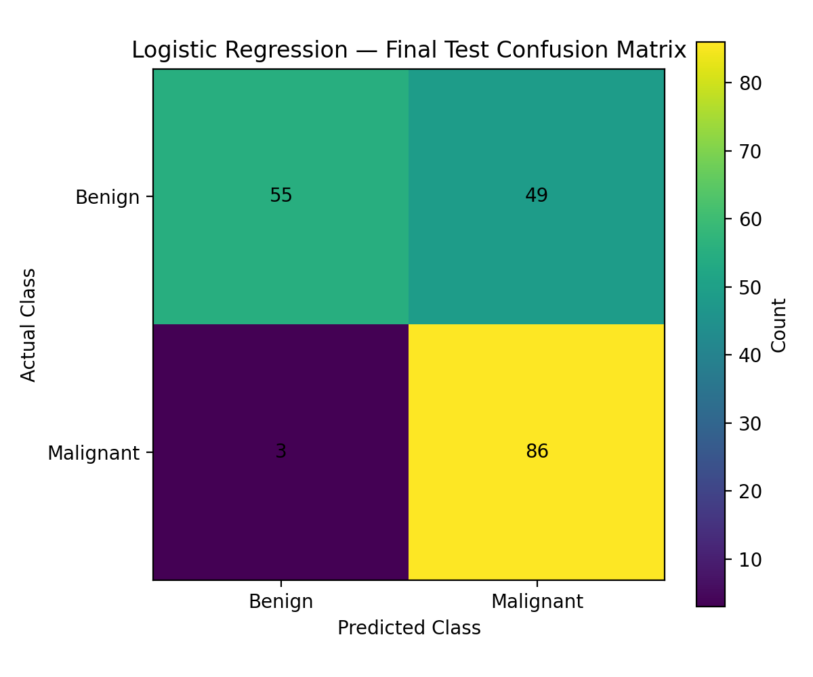
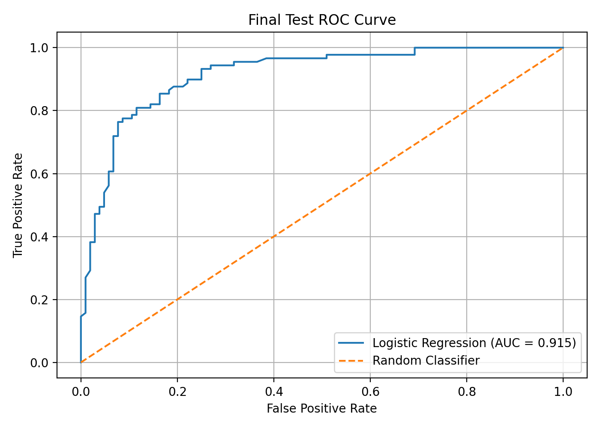
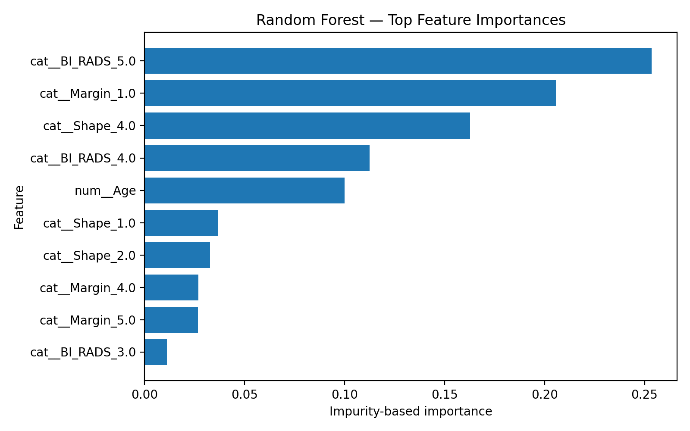
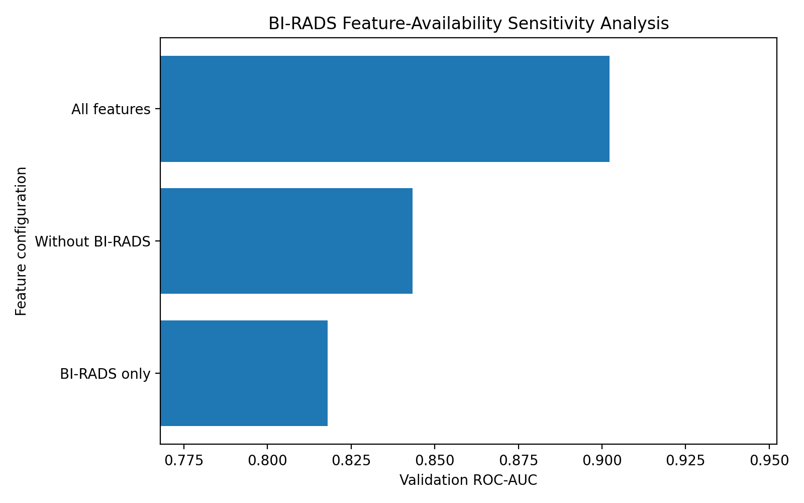

# Cost-Sensitive Mammographic Mass Classification

## Project Overview

This project investigates a cost-sensitive machine learning approach for classifying mammographic masses as benign or malignant using the UCI Mammographic Mass dataset.

The goal is to explore how model evaluation and decision thresholds can account for the higher cost of false-negative predictions. This project is for academic research and educational purposes; it is not a clinical diagnostic system.

## Dataset

The dataset contains 961 observations and five predictive attributes:

* BI-RADS assessment
* Patient age
* Mass shape
* Mass margin
* Mass density

**Target:** Severity (benign or malignant)

Class distribution:

* Benign: 516
* Malignant: 445

The dataset contains missing values and requires preprocessing before model training. Please consult the original dataset source for its documentation and usage conditions.

## Methods

Two classification models were investigated:

* Logistic Regression
* Random Forest

The workflow includes data preprocessing, stratified train/validation/test splitting, cross-validation, model evaluation, and decision-threshold analysis.

A cost-sensitive decision rule assigns a higher penalty to false negatives than false positives:

**Cost = 5 × FN + FP**

where FN represents false negatives and FP represents false positives.

## Results

### Cross-validation comparison

| Model               | Accuracy | Precision | Recall | F1-score | ROC-AUC |
| ------------------- | -------: | --------: | -----: | -------: | ------: |
| Logistic Regression |   0.8143 |    0.8030 | 0.7937 |   0.7976 |  0.8958 |
| Random Forest       |   0.8108 |    0.7863 | 0.8124 |   0.7985 |  0.9036 |

### Final Logistic Regression test evaluation

At the selected decision threshold of 0.15:

| Metric               | Result |
| -------------------- | -----: |
| Accuracy             | 73.06% |
| Precision            | 63.70% |
| Sensitivity (Recall) | 96.63% |
| Specificity          | 52.88% |
| F1-score             | 76.79% |
| ROC-AUC              | 0.9149 |
| False positives      |     49 |
| False negatives      |      3 |

The selected threshold prioritizes sensitivity, resulting in fewer false negatives but more false positives. These results illustrate the trade-off involved in cost-sensitive decision-making.

## Figures

### Final Confusion Matrix



### Final ROC Curve



### Random Forest Feature Importance



### BI-RADS Ablation AUC



## BI-RADS Ablation Analysis

An additional experiment compared model performance with and without the BI-RADS attribute.

| Experiment      | ROC-AUC | Accuracy |
| --------------- | ------: | -------: |
| With BI-RADS    |  0.9023 |   83.33% |
| Without BI-RADS |  0.8434 |   77.60% |

The comparison suggests that BI-RADS contributes useful predictive information in this dataset. However, its availability, interpretation, and potential relationship to the target must be considered when evaluating whether a model would be useful in a real-world setting.

## Limitations

* The evaluation uses a single public dataset and does not establish generalization to other hospitals or patient populations.
* No external validation has been performed.
* The dataset is relatively small for establishing clinical reliability.
* Lowering the decision threshold increases sensitivity but also increases false positives.
* BI-RADS may introduce target-related information or data leakage concerns, so results with and without this attribute should be interpreted separately.
* The model has not been evaluated for clinical workflow integration or prospective patient outcomes.
* The results do not demonstrate that the model is safe or suitable for clinical deployment.

## Reproducibility

The repository contains the analysis notebook, result tables, and figures.

To set up the Python environment:

```bash
pip install -r requirements.txt
```

Then open the notebook in Jupyter:

```bash
jupyter notebook
```

Open the notebook inside the `notebooks/` directory. The dataset itself is not included in this repository; obtain it from the original source and follow the notebook's expected file path and preprocessing instructions.

## Repository Structure

```text
mammographic-mass-classification/
├── README.md
├── LICENSE
├── requirements.txt
├── notebooks/
├── results/
└── figures/
```

## Tools

* Python
* pandas
* NumPy
* scikit-learn
* Matplotlib
* Seaborn
* Jupyter Notebook

## Disclaimer

This project is an academic machine learning exercise. It is not intended for diagnosis, treatment decisions, or direct clinical use. Independent validation, clinical review, and appropriate regulatory and ethical assessment would be required before any clinical application.

## Dataset Reference

Woods, D. C., Kegelmeyer, W. P., Bowyer, K. W., and Moore, J. (1993). *Mammographic Mass Data Set*. UCI Machine Learning Repository.

Dataset page: https://archive.ics.uci.edu/dataset/161/mammographic+mass
